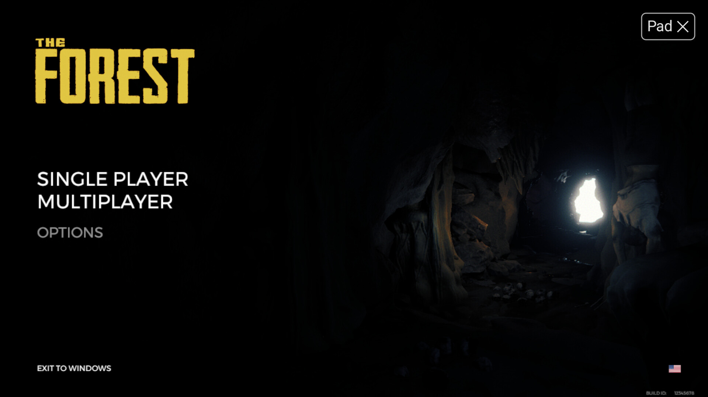
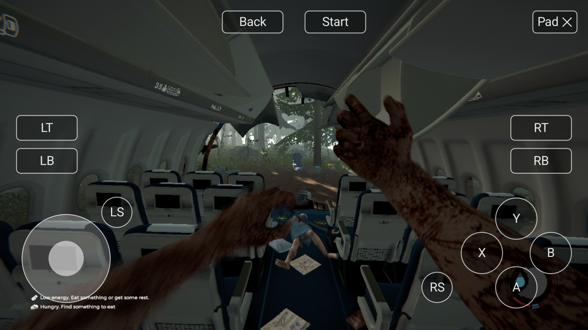
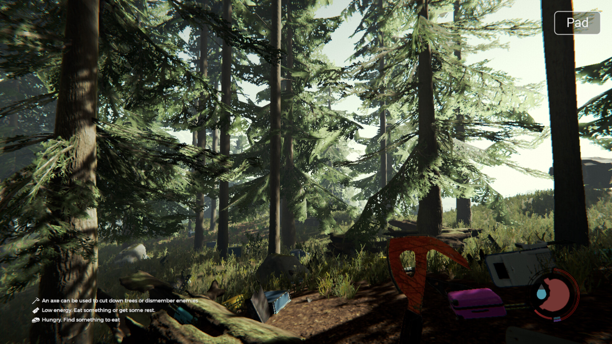

# The Forest – Android-Port (selbst bauen)

Ein nativer Android-Port (`arm64-v8a`) der PC-Version von **The Forest** (Unity 5.6.5p4, Win64, Direct3D 11, FMOD Studio), umgesetzt als **statische Rekompilierung**: Der x86-64-Maschinencode von `TheForest.exe` und den vier nativen Win64-Plugins (`fmod.dll`, `fmodstudio.dll`, `CSteamworks.dll`, `UnityImageNativePlugin.dll` — insgesamt **246.400 Funktionen** in **619 C-Units**) wird vorab nach C übersetzt und mit dem Android NDK nativ für ARM64 kompiliert. C#-Skripte laufen nativ auf einer für ARM64 kreuzkompilierten **Unity-Mono-4.8**-Runtime (Boehm GC), Direct3D 11 über **DXVK Native 1.9.2b** auf Vulkan 1.1 und FMOD-Audio über eine native WASAPI-→-**SDL3**-Brücke — kein Emulator, kein Wine, kein Box64.

**Hier gibt es keine fertige APK und keine Dateien aus dem Spiel.** Du baust die APK selbst aus **deiner eigenen**, legal erworbenen PC-Version: Der Build übersetzt deine fünf Win64-Binaries lokal auf deinem Rechner. Dieses Repository enthält ausschließlich eigenen Runtime-, Bridge-, Build-, Patch- und Android-Wrapper-Code (keinen Spielcode, keine Assets). Die App importiert die Spieldaten (`TheForest.exe`, `TheForest_Data/`) von deiner eigenen Kopie auf dem Gerät. Die erzeugte APK enthält aus deinen Binaries rekompilierten Code und ist nur für dich selbst bestimmt, nicht zum Weitergeben. *The Forest* ist © Endnight Games Ltd.; dieses Projekt steht in keiner Verbindung zum Hersteller.

*English version: [README.md](README.md)*

## Screenshots

<table>
  <tr>
    <td width="50%"><br><sub>3D-Höhlen-Titelbildschirm auf dem AYN Odin 3 (1280×720), stabile 60 fps</sub></td>
    <td width="50%"><br><sub>Aufwachen im abgestürzten Flugzeugwrack mit eingeblendetem PadView</sub></td>
  </tr>
  <tr>
    <td colspan="2" align="center"><br><sub>3D-Wald-Gameplay im Freien auf dem AYN Odin 3 (1280×720): Kiefernwald, Flugzeugaxt, HUD, FMOD-Audio</sub></td>
  </tr>
</table>

## Status

Spielbarer Singleplayer (`0.2.0`). Auf echter Android-Hardware verifiziert (**AYN Odin 3** und **Samsung Galaxy Tab S8 Ultra**): Boot, 3D-Höhlen-Titelbildschirm, NGUI-Menüs, Neues Spiel, `ForestMain_v08`-Open-World-Laden (`0` Mono-/Astar-/ItemDatabase-Exceptions), Flugzeugabsturz-Intro & Skip, 3D-Wald-Erkundung im Freien, FMOD-Studio-Audio (WASAPI → SDL3), physischer Controller + On-Screen-`PadView`, automatisches Entpacken von ZIP64-Datenpaketen, automatisches Mobil-Grafik-Preset beim Erststart (`FullRes`-Texturen + `FXAA`) sowie Background/Resume-Lifecycle (gleiche PID, persistenter Adreno-`VkPipelineCache`). Technisches Protokoll: [`port/RECOMP_STATUS.md`](port/RECOMP_STATUS.md).

| Gerät | GPU | Auflösung | Titelbildschirm | 3D-Wald (Open World, `0.2.0`) | RAM (PSS) |
|---|---|---|---|---|---|
| Samsung Galaxy Tab S8 Ultra (Snapdragon 8 Gen 1) | Adreno 730 | 1280×800 | **60,4 fps** (`p50 = 16,5–16,7 ms`) | **30,9–34,2 fps** (`p50 = 27,5–32,6 ms`, vorher `9,8 fps` in `0.1.0` — **3,3×–3,6× schneller**) | `2,98 GB` In-Game |
| AYN Odin 3 (Android 15, Snapdragon 8 Elite) | Adreno 830 | 1280×720 | **59,7–60,3 fps** (`p50 = 16,5–16,8 ms`) | `0.1.0`-Baseline: `14,1–16,3 fps`; `0.2.0` zielt mit dem 3,3×–3,6× Speedup auf **~50–60 fps** | `1,11 GB` Titel / `2,07 GB` In-Game |

Voraussetzungen: `arm64-v8a`-Android 10+ (API 29+), Vulkan 1.1, **ab ca. 6 GB RAM**, ca. 2,2 GB freier Speicher für Spieldaten und Shader-Caches. Verifiziert auf Qualcomm Adreno 730 und Adreno 830; Mali-/Xclipse-GPUs sind ungetestet.

## Voraussetzungen für den Build

- Deine eigene PC-Installation von **The Forest** (Win64, Unity `5.6.5p4`) mit genau diesen 5 Win64-PE-Dateien:
  - `TheForest.exe` — SHA-256 `2e93a06b8bd865d5aa0ee7257adc7cdfd3d3b8bd182584ef77d7df6bb936c943`
  - `TheForest_Data/Plugins/fmod.dll` — SHA-256 `76157845d72b2144c755f66c9359ba24a2f173e1518afac0d058626f70b6ec9a`
  - `TheForest_Data/Plugins/fmodstudio.dll` — SHA-256 `cf9bbdebab60ec6212d2222788c95e326d901c6dc47b106c4e63c5f9261ad3e5`
  - `TheForest_Data/Plugins/CSteamworks.dll` — SHA-256 `014b8d88f40584ec724c06abcdefcc40e81a4246da692a3468d7b6b6f243fc8f`
  - `TheForest_Data/Plugins/UnityImageNativePlugin.dll` — SHA-256 `061ba680e7c3e63fd9bf077e3e76c207dc3a8fb22b2365dcd3472bc67c52f051`
  *(Andere Versionen scheitern voraussichtlich an der Hash-Prüfung; `FORCE=1` nur setzen, wenn Lift-Einstellungen angepasst werden sollen.)*
- **Docker** (Linux, macOS oder Windows mit WSL2), **≥ 16 GB RAM**, **ca. 30 GB freier Speicher** und Internetzugang (Android SDK/NDK und gepinnte Drittanbieter-Quellen werden beim Build geladen).

## Build

```sh
git clone https://github.com/zwaetschge/theforest-android.git
cd theforest-android
./build.sh "/pfad/zu/The Forest"
```

Ergebnis: `out/TheForest-Android-0.2.0.apk` (ca. 64 MB).

Was `./build.sh` ausführt (in Docker über `docker/Dockerfile` und `tools/build.sh`):

1. Prüft die SHA-256-Prüfsummen aller fünf Win64-PE-Module deiner PC-Version.
2. Lädt die gepinnten Drittanbieter-Quellen (`tools/fetch_deps.sh`): `pcrecomp` (+ `tools/patches/pcrecomp-theforest.patch`), `dxvk-native` `native-1.9.2b`, `Unity-Technologies/mono` `unity-5.6-mbe` (+ `tools/patches/mono-unity56-android.patch`) und `SDL 3.2.12`.
3. Rebased die fünf PE-Module auf feste virtuelle Adressen (`tools/rebase.py`), katalogisiert `.pdata`, liftet alle 246.400 x86-64-Funktionen in 619 C-Dateien unter `gen/` (bleibt lokal) und wendet native ARM64-NEON-/Intrinsic-Hotpath-Patches an (`tools/patch_gen.py`).
4. Bereitet DXVK Native D3D11 für Android vor (`gfx/dxvk/prepare.py`) und kompiliert die internen Vulkan-1.1-Shader (`gfx/dxvk/shaders.py`).
5. Kreuzkompiliert Unity Mono 4.8 (Boehm GC) für `arm64-v8a` (`tools/build_mono_android.sh`) und baut die 13 Open-Source-Mono-4.8-BCL-DLLs (`tools/build_mono_bcl.sh`) in `assets/mono_bcl/`.
6. Kompiliert `libmain.so` (**614,5/619 Units = 99,3 %** mit `-O2 -march=armv8.2-a`, nur noch 4,5 Units mit `-O0` laut `config/o0_host.txt` + `0018`-Tail-Pragma) + `libSDL3.so` für `arm64-v8a` mit Android NDK `27.3.13750724`.
7. Baut und signiert `out/TheForest-Android-0.2.0.apk` per Gradle (erzeugt automatisch einen wiederverwendbaren Keystore in `work/release.keystore` oder nutzt `TF_KEYSTORE*`).

Wenig RAM? Mit `JOBS=4 ./build.sh ...` begrenzt du die parallelen Compiler-Jobs. Auf Linux ohne Docker genügen die Pakete aus `docker/Dockerfile` und direkt `sh tools/build.sh "/pfad/zu/The Forest"`.

## Installieren & Spielen

1. APK installieren: `adb install -r out/TheForest-Android-0.2.0.apk`
2. Eigene PC-Spieldaten importieren (ca. 1,99 GB: `TheForest.exe` und `TheForest_Data/`):
   - App starten und über **„Ordner wählen“** den Spielordner auswählen, **oder**
   - den Spielordner als ZIP/ZIP64 packen und über **„Datenpaket (ZIP) wählen“** entpacken (oder in `Android/obb/ch.plum.theforest/` ablegen, dann wird er beim nächsten Öffnen automatisch entpackt), **oder**
   - per USB/ADB nach `Android/data/ch.plum.theforest/files/game/` kopieren.
3. **„Spielen“** tippen.

### Steuerung & Optionen

- **Physischer Controller** (Handheld-Steuerung, Bluetooth, USB): direkt als XInput-Controller 0 gebunden.
- **On-Screen-Pad (`PadView`)**: linker Stick, `A`/`B`/`X`/`Y`, `LB`/`RB`/`LT`/`RT`, `LS`/`RS`, `Back`/`Start`, Wischen rechts dreht die Kamera, kurzes Tippen klickt im Menü, **`Pad ✕`** oben rechts blendet das Pad aus/ein.
- **Auflösung**: standardmäßig 1280 px Breite (`1280×720`, hardware-skaliert durch Android) für maximale Performance; im Launcher optional **„Volle Bildschirmauflösung“** aktivierbar.
- **Grafik-Preset**: beim Erststart (oder einmalig beim Update von `0.1.0`) wird automatisch ein scharfes Mobil-Grafik-Preset (`FullRes`-Texturen + `FXAA` + mobil optimierte Schatten/Physik) für 30–60 fps angewendet; alle Optionen bleiben im Spiel unter `OPTIONS → GRAPHICS` frei anpassbar, und der Launcher bietet zusätzlich einen 1-Tap-Button.
- **Spielstände, Einstellungen & Caches**: liegen unter `Android/data/ch.plum.theforest/files/user/` (`registry.dat`, `C/Users/Player/...`, `vk_pipeline.cache`, `app_process64.dxvk-cache`, `runtime.log`).

## Bekannte Einschränkungen

- **Multiplayer / Steamworks:** offline gestubbt (`runtime/src/steam.c`); alle Singleplayer-Modi laufen vollständig offline.
- **GPU-Abdeckung:** verifiziert auf **Qualcomm Adreno 730 und Adreno 830**; Mali-/Xclipse-GPUs sind ungetestet.

## Lizenz

Der eigene Code in diesem Repository steht unter der **MIT-Lizenz** ([`LICENSE`](LICENSE)). Alle beim Build geladenen Drittanbieter-Komponenten stehen in [`THIRD_PARTY_NOTICES.md`](THIRD_PARTY_NOTICES.md). **The Forest**, dessen Code und Spieldaten sind nicht Bestandteil dieses Repositories und bleiben Eigentum von Endnight Games Ltd.
