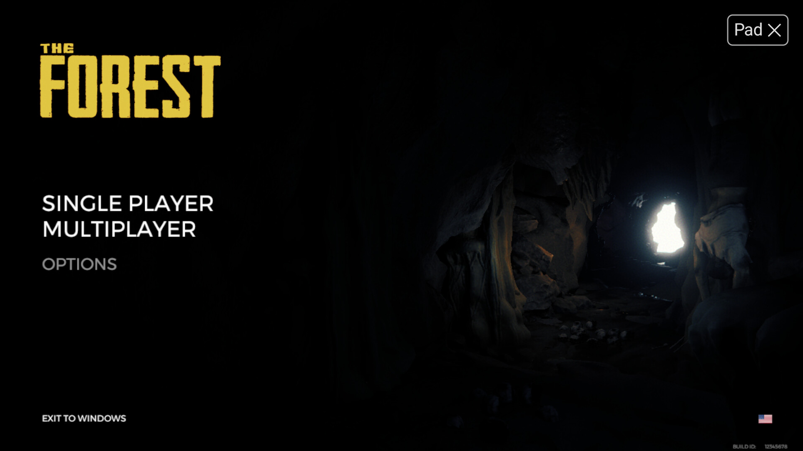
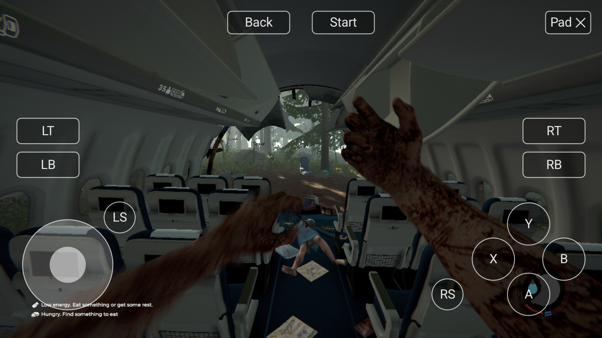
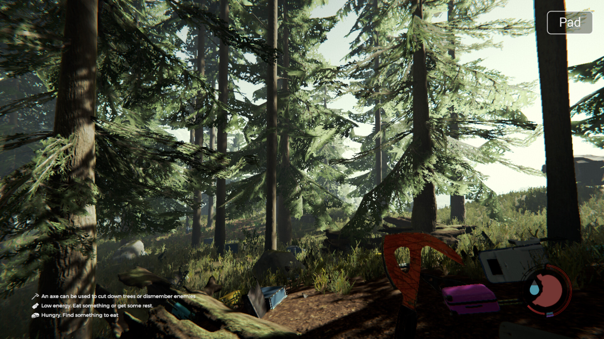

# The Forest – Android Port (Build It Yourself)

A native Android (`arm64-v8a`) port of the PC version of **The Forest** (Unity 5.6.5p4, Win64, Direct3D 11, FMOD Studio), implemented as a **static recompilation**: the x86-64 machine code of `TheForest.exe` and its four native Win64 plugins (`fmod.dll`, `fmodstudio.dll`, `CSteamworks.dll`, `UnityImageNativePlugin.dll` — **246,400 functions** across **619 C units**) is translated ahead-of-time to C and compiled natively for ARM64 with the Android NDK. C# scripts run natively on a cross-compiled ARM64 **Unity Mono 4.8** runtime (Boehm GC), Direct3D 11 runs via **DXVK Native 1.9.2b** on Vulkan 1.1, and FMOD audio routes through a native WASAPI → **SDL3** bridge — no emulator, no Wine, no Box64.

**No prebuilt APK and no game files are distributed here.** You build the APK yourself from **your own** legally purchased PC copy: the build statically recompiles your local Win64 binaries on your machine. This repository contains only original runtime, bridge, build, DXVK/Mono/pcrecomp patch, and Android wrapper code (no game code, no game assets). The app imports the game data (`TheForest.exe`, `TheForest_Data/`) from your own copy on the device. The resulting APK contains code recompiled from your binaries and is for personal use only; do not redistribute it. *The Forest* is © Endnight Games Ltd.; this project is unaffiliated with Endnight Games.

*Deutsche Version: [README.de.md](README.de.md)*

## Screenshots

<table>
  <tr>
    <td width="50%"><br><sub>3D Cave Title Screen on AYN Odin 3 (1280×720), locked 60 fps</sub></td>
    <td width="50%"><br><sub>Waking up inside the crashed fuselage with PadView overlay</sub></td>
  </tr>
  <tr>
    <td colspan="2" align="center"><br><sub>Outdoor 3D Forest gameplay on AYN Odin 3 (1280×720): sunlit pines, plane axe, HUD, FMOD audio</sub></td>
  </tr>
</table>

## Status

Playable singleplayer (`0.2.0`). Verified on real Android hardware (**AYN Odin 3** and **Samsung Galaxy Tab S8 Ultra**): boot, 3D cave title screen, NGUI menus, new game creation, `ForestMain_v08` open-world loading (`0` Mono/Astar/ItemDatabase exceptions), plane crash intro & skip, outdoor 3D Forest exploration, FMOD Studio WASAPI → SDL3 stereo audio, physical gamepad + toggleable on-screen `PadView`, automatic ZIP64 data-pack unpacking, automatic first-run crisp mobile graphics preset (`FullRes` textures + `FXAA`), and background/resume lifecycle (same PID, persistent Adreno `VkPipelineCache`). Technical log: [`port/RECOMP_STATUS.md`](port/RECOMP_STATUS.md).

| Device | GPU | Resolution | Title Screen | Open-World Forest (`0.2.0`) | Memory (PSS) |
|---|---|---|---|---|---|
| Samsung Galaxy Tab S8 Ultra (Snapdragon 8 Gen 1) | Adreno 730 | 1280×800 | **60.4 fps** (`p50 = 16.5–16.7 ms`) | **30.9–34.2 fps** (`p50 = 27.5–32.6 ms`, up from `9.8 fps` in `0.1.0` — **3.3×–3.6× faster**) | `2.98 GB` in-game |
| AYN Odin 3 (Android 15, Snapdragon 8 Elite) | Adreno 830 | 1280×720 | **59.7–60.3 fps** (`p50 = 16.5–16.8 ms`) | `0.1.0` baseline: `14.1–16.3 fps`; `0.2.0` targets **~50–60 fps** with the 3.3×–3.6× speedup | `1.11 GB` title / `2.07 GB` in-game |

Requirements: `arm64-v8a` Android 10+ (API 29+), Vulkan 1.1, **≥ 6 GB RAM**, ~2.2 GB free storage for game data and shader caches. Verified on Qualcomm Adreno 730 and Adreno 830; Mali and Xclipse GPUs are untested.

## Build Requirements

- Your own PC installation of **The Forest** (Win64, Unity `5.6.5p4`) with these exact 5 PE binaries:
  - `TheForest.exe` — SHA-256 `2e93a06b8bd865d5aa0ee7257adc7cdfd3d3b8bd182584ef77d7df6bb936c943`
  - `TheForest_Data/Plugins/fmod.dll` — SHA-256 `76157845d72b2144c755f66c9359ba24a2f173e1518afac0d058626f70b6ec9a`
  - `TheForest_Data/Plugins/fmodstudio.dll` — SHA-256 `cf9bbdebab60ec6212d2222788c95e326d901c6dc47b106c4e63c5f9261ad3e5`
  - `TheForest_Data/Plugins/CSteamworks.dll` — SHA-256 `014b8d88f40584ec724c06abcdefcc40e81a4246da692a3468d7b6b6f243fc8f`
  - `TheForest_Data/Plugins/UnityImageNativePlugin.dll` — SHA-256 `061ba680e7c3e63fd9bf077e3e76c207dc3a8fb22b2365dcd3472bc67c52f051`
  *(Other versions will likely fail hash verification; set `FORCE=1` only if you intend to adapt lift settings.)*
- **Docker** (Linux, macOS, or Windows with WSL2), **≥ 16 GB RAM**, **~30 GB free disk space**, and internet access (Android SDK/NDK and pinned third-party sources are fetched during the build).

## Build

```sh
git clone https://github.com/zwaetschge/theforest-android.git
cd theforest-android
./build.sh "/path/to/The Forest"
```

Output: `out/TheForest-Android-0.2.0.apk` (~64 MB).

What `./build.sh` does (inside Docker via `docker/Dockerfile` and `tools/build.sh`):

1. Verifies the SHA-256 hashes of all five Win64 PE modules from your PC copy.
2. Fetches pinned third-party sources (`tools/fetch_deps.sh`): `pcrecomp` (+ `tools/patches/pcrecomp-theforest.patch`), `dxvk-native` `native-1.9.2b`, `Unity-Technologies/mono` `unity-5.6-mbe` (+ `tools/patches/mono-unity56-android.patch`), and `SDL 3.2.12`.
3. Rebases the five PE modules to fixed virtual addresses (`tools/rebase.py`), catalogs `.pdata`, lifts all 246,400 x86-64 functions into 619 C files under `gen/` (kept local), and applies native ARM64 NEON / intrinsic hot-path patches (`tools/patch_gen.py`).
4. Prepares DXVK Native D3D11 for Android (`gfx/dxvk/prepare.py`) and compiles its built-in Vulkan 1.1 shaders (`gfx/dxvk/shaders.py`).
5. Cross-compiles Unity Mono 4.8 (Boehm GC) for `arm64-v8a` (`tools/build_mono_android.sh`) and builds the 13 open-source Mono 4.8 BCL DLLs (`tools/build_mono_bcl.sh`) bundled in `assets/mono_bcl/`.
6. Compiles `libmain.so` (**614.5/619 units = 99.3%** at `-O2 -march=armv8.2-a`, only 4.5 units at `-O0` per `config/o0_host.txt` + `0018` cold-tail pragma) + `libSDL3.so` for `arm64-v8a` using Android NDK `27.3.13750724`.
7. Builds and signs `out/TheForest-Android-0.2.0.apk` with Gradle (auto-generates a reusable keystore in `work/release.keystore`, or uses `TF_KEYSTORE*`).

Low on RAM? Pass `JOBS=4 ./build.sh ...` to cap parallel compilation jobs. On Linux without Docker, install the packages from `docker/Dockerfile` and run `sh tools/build.sh "/path/to/The Forest"` directly.

## Install & Play

1. Install the APK: `adb install -r out/TheForest-Android-0.2.0.apk`
2. Import your PC game data (~1.99 GB: `TheForest.exe` and `TheForest_Data/`):
   - Open the app and tap **"Ordner wählen"** to pick your game folder via Android SAF, **or**
   - pack your game folder into a ZIP/ZIP64 archive and pick it via **"Datenpaket (ZIP) wählen"** (or drop it into `Android/obb/ch.plum.theforest/` for automatic unpacking on next launch), **or**
   - copy via USB/ADB into `Android/data/ch.plum.theforest/files/game/`.
3. Tap **"Spielen"**.

### Controls & Options

- **Physical Controller** (built-in handheld controls, Bluetooth, USB): mapped directly to XInput slot 0.
- **On-Screen Pad (`PadView`)**: left stick, `A`/`B`/`X`/`Y`, `LB`/`RB`/`LT`/`RT`, `LS`/`RS`, `Back`/`Start`, right-half swipe for camera look, short tap for menu clicks, and **`Pad ✕`** in the top-right corner to toggle visibility.
- **Resolution**: defaults to 1280 px width (`1280×720`, hardware-scaled by Android) for best performance; optional **"Volle Bildschirmauflösung"** toggle in the launcher.
- **Graphics Preset**: on first launch (or one-time upgrade from `0.1.0`), applies a crisp mobile graphics preset (`FullRes` textures + `FXAA` + mobile-tuned shadows/physics) for 30–60 fps; all settings remain freely adjustable in-game under `OPTIONS → GRAPHICS`, and the launcher includes a one-tap reset button.
- **Saves, Config & Caches**: stored under `Android/data/ch.plum.theforest/files/user/` (`registry.dat`, `C/Users/Player/...`, `vk_pipeline.cache`, `app_process64.dxvk-cache`, `runtime.log`).

## Known Limitations

- **Multiplayer / Steamworks:** Offline-stubbed (`runtime/src/steam.c`); singleplayer modes run fully offline.
- **GPU Support:** Verified on Qualcomm Adreno 730 and Adreno 830; Mali and Xclipse GPUs are untested.

## License

Original code in this repository is licensed under the **MIT License** ([`LICENSE`](LICENSE)). Third-party open-source components fetched during the build are listed in [`THIRD_PARTY_NOTICES.md`](THIRD_PARTY_NOTICES.md). **The Forest**, its code, and its assets are not included in this repository and remain the property of Endnight Games Ltd.
